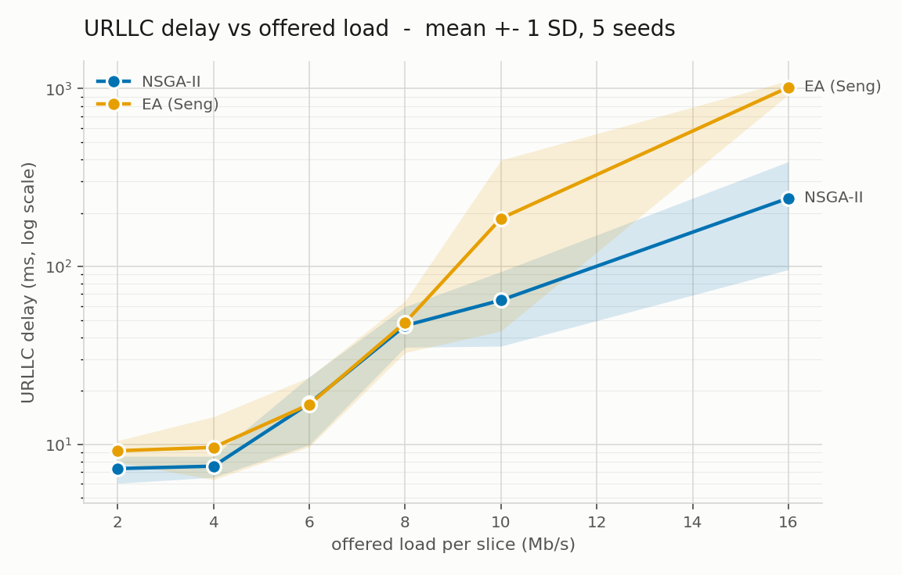
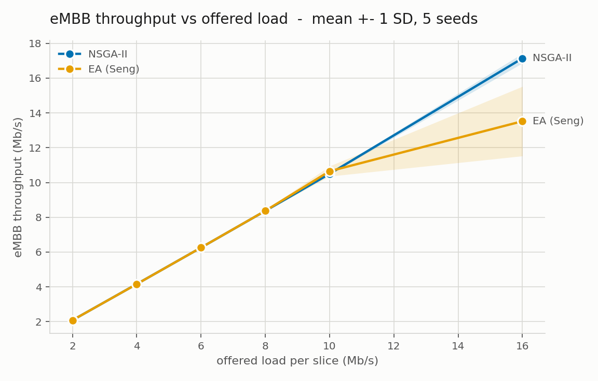

# Resource Allocation and Routing with NSGA-II for Network Slicing in Wireless Mesh Networks

## Result: routing, measured standalone

NSGA-II against Seng et al.'s scalar EA on a 10x10 802.11ax ad-hoc mesh, 50 m spacing, three
IMT-2020 slices (eMBB / URLLC / mMTC) at equal offered load.

**Allocation is switched off in both arms** (`--sliceQdisc` off, Linux `fq_codel` on every radio),
so the only difference between them is how routes are scored.

90 runs. 5 GA seeds per cell, 40 s of traffic, the last 10 s measured. Mean +- sd across seeds.

| load | arm | URLLC delay (ms) | URLLC thpt (Mb/s) | eMBB delay (ms) | eMBB thpt (Mb/s) | n |
|---:|---|---:|---:|---:|---:|---:|
| 2 | NSGA-II | 7.3 +- 1.3 | 2.08 +- 0.00 | 8.1 +- 1.5 | 2.08 +- 0.00 | 5 |
| 2 | EA (Seng) | 9.2 +- 1.3 | 2.08 +- 0.00 | 9.6 +- 1.5 | 2.08 +- 0.00 | 5 |
| 4 | NSGA-II | 7.5 +- 1.0 | 4.16 +- 0.00 | 10.8 +- 2.8 | 4.16 +- 0.00 | 5 |
| 4 | EA (Seng) | 9.6 +- 4.7 | 4.16 +- 0.00 | 11.8 +- 8.0 | 4.16 +- 0.00 | 5 |
| 6 | NSGA-II | 17.0 +- 7.0 | 6.25 +- 0.01 | 26.7 +- 13.9 | 6.26 +- 0.01 | 5 |
| 6 | EA (Seng) | 16.7 +- 7.1 | 6.25 +- 0.00 | 23.3 +- 8.1 | 6.26 +- 0.00 | 5 |
| 8 | NSGA-II | 46.5 +- 12.9 | 8.22 +- 0.32 | 74.2 +- 17.1 | 8.37 +- 0.03 | 5 |
| 8 | EA (Seng) | 48.4 +- 15.6 | 8.35 +- 0.02 | 69.2 +- 37.7 | 8.37 +- 0.04 | 5 |
| 10 | NSGA-II | **64.6 +- 29.0** | 10.46 +- 0.03 | **104.1 +- 41.6** | 10.50 +- 0.05 | 5 |
| 10 | EA (Seng) | 186.3 +- 209.9 | 10.55 +- 0.15 | 239.3 +- 295.4 | 10.65 +- 0.29 | 4 |
| 16 | NSGA-II | **242.2 +- 146.2** | **17.03 +- 0.23** | **301.5 +- 113.9** | **17.14 +- 0.28** | 5 |
| 16 | EA (Seng) | 1017.3 +- 91.3 | 13.72 +- 0.40 | 1173.5 +- 188.3 | 13.52 +- 2.00 | 3 |

### Reading it

**Below load 8 the arms are indistinguishable.** Throughput matches to two decimals with 0% loss,
because the mesh carries the offered load whichever routes are installed. Those rows are the
control: they show the medium is not the bottleneck, so the separation above load 8 is routing.

**At load 16 NSGA-II delivers 4.2x lower URLLC delay and 24% more throughput**, with error bars
that do not overlap on either measure.

**The arms also differ in reliability.** Three runs in the sweep ended INVALID — the queue disc
still held packets when traffic stopped, so their delay and loss figures are truncated. All three
are EA's; NSGA-II completed 45 of 45. This is why EA's n is 4 at load 10 and 3 at load 16, and
because the excluded runs are its worst, **1017 ms is a lower bound on EA at load 16, not a centre
estimate**.

Per-seed spread at load 10 (URLLC delay, ms) shows the same thing:

```
NSGA-II    28.7   49.0   61.8   78.6   104.9      3.7x
EA         45.6   46.8  162.7  216.6  490.2      10.8x
```

EA's best two seeds beat NSGA-II's mean; its worst three are 3-10x worse. A control plane installs
**one** GA draw, so that spread is a property of the method as deployed, not noise to average away.

### URLLC delay vs offered load



### eMBB throughput vs offered load



### Caveats

- Throughput is measured at the **IP layer** and includes the 28-byte IP+UDP header, so delivered
  figures run ~4% above an offered load specified in payload terms.
- Both arms share one link table (`results/linktable/10/10seed1.csv`). Ten independently measured
  tables agree to 0.02%, so varying it changes nothing.
- Demand feeds the GA, so each load point re-optimises its own routes. Compare **down** a column
  (arm against arm at one load); reading **across** loads mixes load change with route change.
- The Seng port carries their eq 3 weight and over-capacity rule with no invented constant. Their
  eq 9 is not implementable as published (`alpha` and `beta` have no values anywhere in the paper),
  so **no result here is a reproduction of their published numbers**.

## Layout

| path | holds |
|---|---|
| `harness/` | the testbed — one `main` executable |
| `nsga/` | NSGA-II routing backbone, and the Seng baseline |
| `ofdma/` | per-slice allocation (ns-3-free) |
| `gates/` | standalone validation experiments |
| `fail/` | archived dead ends, kept as evidence |
| `results/linktable/` | measured link tables, `<grid>/<grid>seed<N>.csv` |
| `results/raw/` | extracted measurements, one CSV per experiment |
| `results/codes/` | the scripts that turn run output into tables and figures |
| `results/show/` | figures and summary tables — output of `codes/` only |

`results/etc/` is run-output staging and is not tracked.

## Run

```
./ns3 run mesh-slicing/main -- --gridWidth=10 --spacing=50
```

Reproduce the table above:

```
./ns3 run "mesh-slicing/main --gaRoute --gridWidth=10 \
    --linkTable=scratch/mesh-slicing/results/linktable/10/10seed1.csv \
    --router=nsga --gaSeed=1 --embbDemand=16 --urllcDemand=16 --mmtcDemand=16 \
    --trafficSec=40 --measureSec=10 --plainQdisc=ns3::FqCoDelQueueDisc \
    --resultsDir=scratch/mesh-slicing/results/etc/run-a/"

python3 results/codes/extract.py results/raw/out.csv <logs>
python3 results/codes/plot.py results/raw/out.csv URLLC 1,2,3,4,5 2,4,6,8,10,16 full
```
